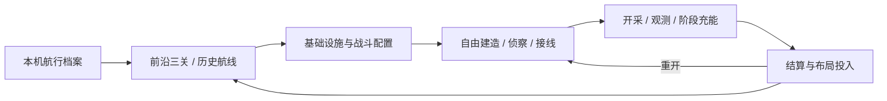
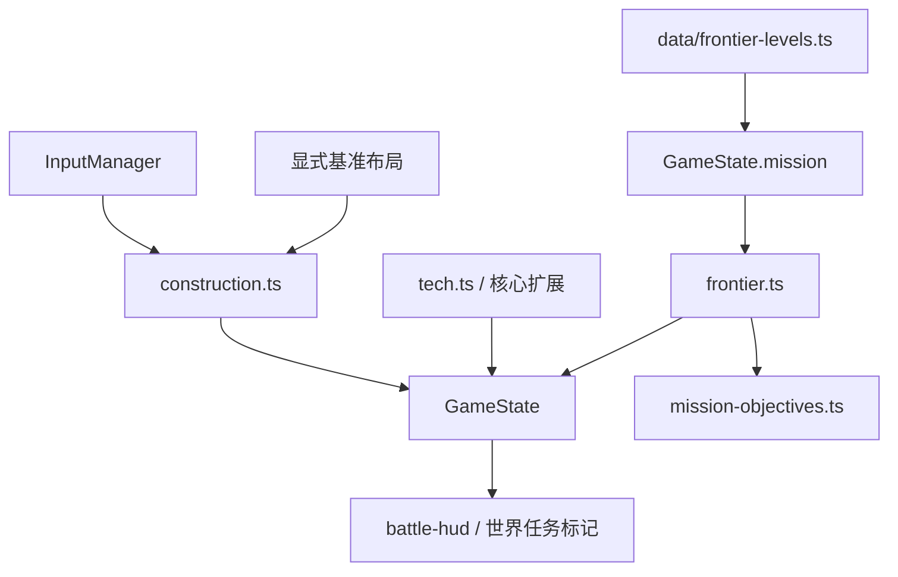
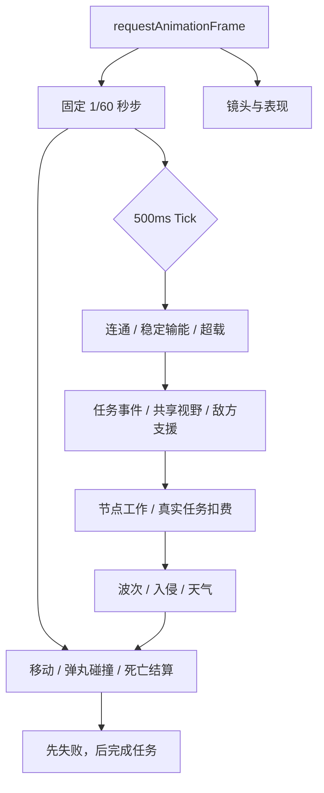
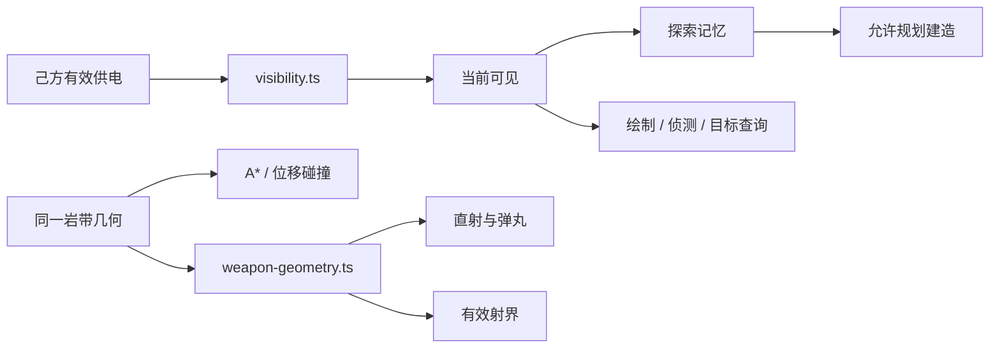

# 当前架构

更新于2026-10-23。当前验证与复现方式见[DEVELOPMENT.md](DEVELOPMENT.md)，本轮实际操作与截图已交付待独立验收；平衡参数只在代码配置维护。

## 体验流程

菜单由 Screen 管理 DOM 生命周期；世界、HUD、模态面板采用 Canvas。启动前加载统一设施素材，完成后挂载首屏。设施图同时用于世界、建造栏、配置档案与标题，避免图标与实际单位外观脱节。

菜单空间由 screen-layout.ts 计算，Screen 统一设置 CSS 变量并在尺寸变化时重绘；配置、航线和档案通过分页组织，状态仍由各屏幕自身持有。建造的 PlacementStatus 由 construction.ts 定义，Input 取实际位置报价，Game 传给 UI，固定反馈栏和场内预览共用；连线拒绝原因来自 graph.ts 中同一判定，canConnect 保留原布尔接口。航图绘制、点击映射和面板边界使用 canvas-ui.ts 中的公共矩形计算。

## 数据与命令

GameState.frontier 只保存本局进度、投资回收和必要统计，关卡规则来自唯一配置。旧关卡编号与本机档案保持，新增样板使用独立编号。所有验证布局通过正常收费与侦察限制，不参与普通玩家输入。

## 模拟与供电

连通从己方核心出发，包括有效双端虫洞中继。输能使用同一快照，按谐和容量估计均衡需求，并依据节点耦合强度限步；随后按源储备、目标空间共同分摊。虫洞通道与物理链路共用输能结算，电流表现读取实际流动方向与数值。

节点效果与任务均在 Tick 中结算；渲染不生成货币、不取得观测数据、不触发战斗伤害。保留上一个 Tick 的工作反馈，是为了正确显示已经扣费的持续工作。

## 信息与遮挡

迷雾绘制缓存由实际信息变化驱动。任务设施与矿脉位置属于已知战术资料；敌人仅在有效实时侦测下显示。攻击记录驱动短暂命中与无人机光效，装饰随机和模拟随机分离。

## 表现与持久化

- data/facility-art.ts：固定功能色、轮廓、素材地址与 alpha 边界；facility-art.ts：透明素材加载、小尺寸缓存、武器转向与等级标记。图片及生成来源保存在 public/art/facilities/。
- fleet-art.ts：实际移动朝向的敌军；terrain-art.ts：与碰撞轮廓对应的岩带。
- world-facilities.ts：状态、矿脉、任务标记与共享射界；renderer.ts：世界合成、视野与航图。
- battle-hud.ts：目标、常驻建造栏、设施/批量详情；ui.ts：通知、研究、手册、暂停与结算。
- 设施投资、当前研究、电网、探索与任务进度是本局状态，重开重建；本机档案保留通关、统计、成就及已发现联动。
- 素材来源记录与构建诊断属于源码资料，不写入玩家档案。
